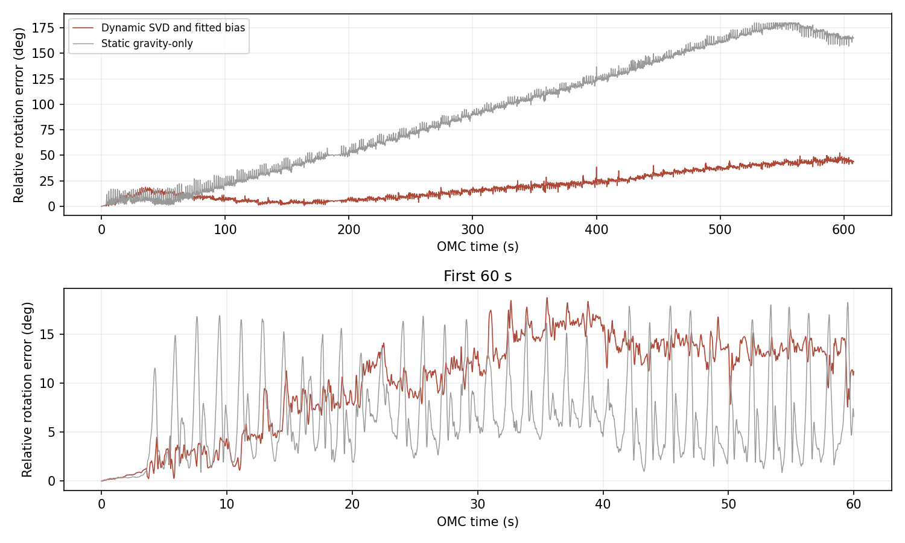

# IMU–OMC Kinematic Validation

**2026-2 센서이론·신호처리 I · MOBI311 · Minseo Kim**

발목에 부착한 IMU의 자세와 위치 추정값을 Vicon 광학 모션캡처(OMC) 데이터와 비교한 프로젝트입니다. 원본 CSV, 최종 분석에 필요한 코드, 계산 결과만 보관합니다. 보고서는 사용자가 추가할 수 있도록 `report/`에 보고서 파일을 넣지 않았습니다.

## 폴더 구성

최상위에는 아래 **4개 폴더와 이 README.md**만 있습니다. 하위 폴더는 없습니다.

| 폴더 | 내용 |
|---|---|
| `raw_csv/` | 본 측정의 원본 `imu.csv`, `omc_vicon.csv` 각 1개 |
| `code/` | Tasks 2–5 최종 분석 코드, Task 1 마커 진단·복원 실험 코드, 의존성 목록 |
| `results/` | 최종 분석의 CSV·JSON·PNG, Task 1 결과와 후속 분석에 필요한 처리 데이터 |
| `report/` | 보고서용 폴더. GitHub에서 폴더를 유지하기 위한 빈 `.gitkeep`만 포함 |

중복 원본 CSV, 예비 측정, 과거 코드·분석 패키지, 보고서와 초안, 과제 지침, 스크린샷, 보조 3D 시각화, 이전 Week 6 실습 자료는 제외했습니다. 보존한 원본 CSV와 기존 결과 파일의 내용은 변경하지 않았습니다. Python 코드에서는 새 폴더 구조에 맞춰 입출력 경로와 Task 1 출력 파일명만 조정했습니다.

## 주요 파일

| 파일 | 용도 |
|---|---|
| [raw_csv/imu.csv](raw_csv/imu.csv) | IMU 원본, 58,488 samples |
| [raw_csv/omc_vicon.csv](raw_csv/omc_vicon.csv) | Vicon 내보내기 CSV, 60,806 frames, 100 Hz |
| [code/run_tasks2to5.py](code/run_tasks2to5.py) | 동기화, 고정 공간 보정, 자세·위치 추정 |
| [code/task1_marker_refinement.py](code/task1_marker_refinement.py) | 마커 거리 검사, 인공 결측 복원 검증 |
| [results/results_summary.json](results/results_summary.json) | Tasks 2–5 전체 수치 요약 |
| [results/task1_summary.json](results/task1_summary.json) | Task 1 진단·인공 결측 검증 요약 |
| [results/omc_refined_task1.csv](results/omc_refined_task1.csv) | 최종 Tasks 2–5에서 사용한 OMC 좌표 |
| [results/task1_initial_OL_to_OG.csv](results/task1_initial_OL_to_OG.csv) | 최종 분석에서 사용한 초기 좌표축 |
| [results/task1_template_mm.csv](results/task1_template_mm.csv) | 최종 분석에서 사용한 마커 기준 형상 |

`results/`에는 실행에 필요한 처리 데이터도 포함됩니다. 특히 위 OMC 좌표·초기 좌표축·기준 형상 3개 파일은 원본 CSV가 아니라 최종 분석의 입력으로 사용된 Task 1 결과이므로 함께 보존했습니다.

## 실행

프로젝트 최상위에서 다음 명령을 실행합니다. Python 3.12.14 환경에서 확인한 패키지 버전을 `code/requirements.txt`에 기록했습니다.

```bash
python -m pip install -r code/requirements.txt
python code/run_tasks2to5.py
```

결과는 `results/`에 저장되며 같은 이름의 결과를 덮어씁니다. 원본 CSV와 `report/`에는 쓰지 않습니다. 실행 시 별도의 하위 폴더를 만들지 않습니다.

Task 1 마커 진단과 인공 결측 실험은 별도로 실행할 수 있습니다.

```bash
python code/task1_marker_refinement.py --demo
```

Task 1 출력에는 `task1_` 접두사를 붙입니다. 이 코드는 진단용 단일 프레임 기준 형상을 사용하며, 최종 Tasks 2–5가 사용하는 기준 형상과 다릅니다. 따라서 `task1_omc_refined.csv`와 `task1_empirical_template_mm.csv`가 후속 분석의 입력을 자동으로 대체하지 않습니다. Tasks 2–5 실행은 위에 명시한 기존 Task 1 결과 3개를 읽습니다.

`task1_pair_distances_medians.png`는 기존에 저장된 별도 편집 그림입니다. 해당 그림의 생성 코드는 확보본에 없어, Task 1 재실행 시에는 `task1_pair_distances.png`가 생성됩니다.

## 분석 방법과 주요 결과

각속도 크기로 시계를 먼저 동기화한 후, 5–120 s의 OMC·IMU 각속도에서 SVD/Kabsch 고정 회전과 자이로 바이어스를 추정합니다. 보정된 자이로를 quaternion으로 적분해 자세를 구하고, 전역 좌표계의 중력 제거 가속도에 BPF와 이중 적분을 적용해 위치를 추정합니다.

| 항목 | 저장된 결과 |
|---|---:|
| 동기화 각속도 크기 상관계수 | 0.971786 |
| 시간 배율 α | 1.00421650 |
| 시간 오프셋 β | −2.473879 s |
| 평균 자세 오차, gravity-only | 91.37° |
| 평균 자세 오차, dynamic SVD + bias | 19.82° |
| 최종 자세 오차, dynamic SVD + bias | 43.73° |
| 위치 RMSE, 0.3–5 Hz | 1,966.72 mm |
| 위치 RMSE, 0.5–7 Hz | 1,892.02 mm |
| 위치 RMSE, 1.1–10 Hz | 2,293.92 mm |




OMC는 자세 초기화와 보정의 기준으로 사용했습니다. IMU 위치는 마커 중심과 같다고 가정했으며, 실제 lever arm 보정이나 ZUPT는 적용하지 않았습니다. Vicon CSV는 내보내기 전에 복원이 수행된 자료이며, 기존 복원 이력은 CSV만으로 판별할 수 없습니다.

## 정리 후 검증

입출력 경로 변경 후 별도 복사본에서 Tasks 2–5와 Task 1 인공 결측 실험을 재실행했습니다. Tasks 2–5 요약의 수치와 Task 1 핵심 진단·복원 수치를 기존 결과와 비교했습니다. 검증 실행으로 생성된 파일은 배포본에 추가하지 않았습니다.
