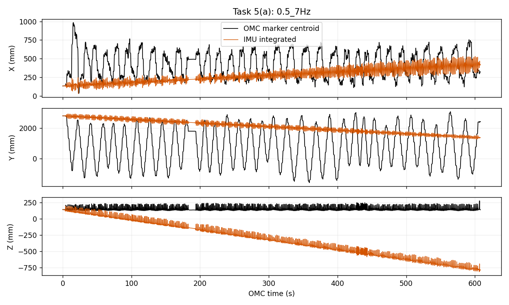

# IMU–OMC Kinematic Validation

**2026-2 센서이론·신호처리 I · MOBI311 · Minseo Kim**

발목에 부착한 IMU의 자세·위치 추정값을 Vicon 광학식 모션캡처(OMC)와 비교한 프로젝트입니다. 네 개의 마커로 얻은 기준 움직임과 IMU 데이터를 시간·좌표계에 맞춰 정렬하고, 자이로 적분과 가속도 이중 적분의 오차를 평가했습니다.

원본 측정 데이터, 분석 코드, 계산 결과, 보고서, 과제 지침과 작업 중 생성한 버전을 함께 보관합니다. 중간 프로젝트가 중심이며, 이전 IMU–모션캡처 비교 실습은 `related/week6_imu_mocap/`에 별도로 정리했습니다.

## 먼저 볼 파일

- [최신 확보 보고서 PDF](reports/latest/MinSeo_Kim_2023170677%281%29.pdf)
- [최신 확보 보고서 Word](reports/latest/MinSeo_Kim_2023170677_GitHub.docx)
- [주 분석 코드](analysis/dynamic_calibration/code/run_tasks2to5.py)
- [전체 수치 결과](analysis/dynamic_calibration/results/results_summary.json)
- [Task 1 마커 복원 코드](analysis/task1/task1_marker_refinement.py)
- [파일 목록과 SHA-256](FILE_INVENTORY.csv)
- [재실행 검증](VERIFICATION.md)

Word 링크는 기존 `3-2` 저장소에서 확보한 보고서를 가리킵니다. 대화에서 확보했던 `MinSeo_Kim_2023170677(6).docx`도 함께 보존했습니다. 실제 제출 여부를 별도로 인증하는 표시는 아닙니다.

## 데이터와 장비

| 항목 | 내용 |
|---|---|
| 측정 대상 | 발목에 부착한 Arduino Nano 33 IMU 모듈과 네 개의 OMC 마커 |
| IMU | 58,488 samples, 610.493 s, 평균 약 95.80 Hz |
| OMC | Vicon, 60,806 frames, 608.05 s, 100 Hz |
| IMU 입력 | 시각, 3축 가속도(g), 각속도(deg/s), 자기장 |
| OMC 입력 | 네 마커의 전역 XYZ 좌표(mm) |
| 분석 좌표계 | 기록된 IMU EUN 채널 → OMC local(OL) → OMC global(OG, ENU) |

## 분석 순서

1. **OMC 마커 품질 검사·복원 검증:** 여섯 마커 쌍의 거리를 검사하고, 인공 결측 구간에 대해 강체 복원과 spline 보간을 검증합니다. 입력 CSV는 Vicon에서 이미 복원된 상태이며, 기존 결측 이력을 CSV만으로 복구할 수 없습니다.
2. **시간 동기화:** 각속도 크기의 상관관계를 이용해 `t_OMC = α(t_IMU − t_IMU,first) + β`를 추정합니다.
3. **고정 공간 보정:** 동기화된 5–120 s의 각속도로 SVD/Kabsch 회전과 상수 자이로 바이어스를 추정하고, 120–600 s 구간에서 각속도 오차를 평가합니다.
4. **자세 추정:** 첫 공통 시각의 OMC 자세로 초기화하고, 보정된 자이로만 quaternion `[x, y, z, w]`로 적분합니다.
5. **위치 추정:** 가속도를 전역 좌표계로 옮긴 후 중력을 제거하고, BPF와 두 번의 사다리꼴 적분을 적용합니다. 세 고정 대역과 운동 주기 기반 대역을 비교합니다.

## 주요 결과

| 평가 항목 | 결과 |
|---|---:|
| 동기화 각속도 크기 상관계수 | 0.971786 |
| 시간 배율 α | 1.00421650 |
| 시간 오프셋 β | −2.473879 s |
| 평균 자세 오차: gravity-only | 91.37° |
| 평균 자세 오차: dynamic SVD + bias | 19.82° |
| 마지막 자세 오차: dynamic SVD + bias | 43.73° |
| 위치 RMSE, 0.3–5 Hz | 1,966.72 mm |
| 위치 RMSE, 0.5–7 Hz | 1,892.02 mm |
| 위치 RMSE, 1.1–10 Hz | 2,293.92 mm |

120–150 s 구간에서 추정한 한 발의 운동 주기는 1.565 s였습니다. 주기 기반 0.192–3 Hz 필터의 위치 RMSE는 2,332.27 mm로, 같은 구간의 고정 0.3–5 Hz 필터(1,970.62 mm)보다 컸습니다. 공간 보정은 자세 오차를 줄였지만 장시간 위치 적분에는 큰 오차가 남았습니다.




## 실행

저장소 최상위 폴더에서 Python 환경을 준비합니다. 아래 명령은 Windows PowerShell에서도 실행할 수 있습니다.

```bash
python -m venv .venv
# Windows PowerShell: .venv\Scripts\Activate.ps1
# macOS/Linux: source .venv/bin/activate
python -m pip install -r requirements.txt
```

보고서의 주 결과인 Tasks 2–5를 다시 계산합니다.

```bash
python analysis/dynamic_calibration/code/run_tasks2to5.py
```

결과는 `analysis/dynamic_calibration/results/`에 갱신됩니다. 원래 결과를 유지하려면 폴더를 복사한 뒤 실행하십시오. 이 코드는 이미 준비된 Task 1 입력을 사용하며 Task 1을 다시 계산하지 않습니다.

Task 1의 진단과 인공 결측 실험만 별도 실행하려면:

```bash
python analysis/task1/task1_marker_refinement.py --input data/raw/omc_vicon.csv --out outputs/task1 --demo
```

Task 1을 새로 실행한 결과가 Tasks 2–5의 입력으로 자동 연결되지는 않습니다. 과거 전체 실행 버전은 `archive/packages/midterm_tasks1_5.zip`에 보존되어 있습니다. 과거 보정 버전의 결과를 주 분석 결과와 혼용하지 마십시오.

새 IMU 기록에 사용하는 로거는 `acquisition/`에 있습니다. `record_imu.py`와 `record_imu(2).py`의 입력 형식 설명을 먼저 확인하고, 로거 실행에 필요한 `pyserial`을 별도로 설치하십시오. 센서 firmware의 출력 시간·가속도·자기장 단위가 로거 옵션과 일치해야 합니다.

## 폴더 안내

| 폴더 | 내용 |
|---|---|
| `analysis/dynamic_calibration/` | 주 분석 코드, 입력 사본, Tasks 2–5 수치·그림, 당시 자동 생성 보고서 |
| `analysis/task1/` | 마커 진단·복원 코드와 기존 예제 결과 |
| `analysis/task1_3d/`, `analysis/task1_report_figures/` | 3D 시각화·보고서 그림 생성 코드와 입력 |
| `data/raw/`, `data/preliminary_recording/` | 확보한 원본 CSV와 예비 측정 기록 |
| `acquisition/` | 시리얼 IMU 로거의 확보 버전 |
| `reports/latest/` | 최신 확보 Word·PDF 보고서 |
| `reports/history/`, `reports/methods_and_drafts/` | 보고서 수정본, Methods 문서, 보정 방식별 초안 |
| `reports/checks/` | 보고서 검사 결과 |
| `figures/`, `visualizations/` | 개별 그림과 인터랙티브 HTML |
| `references/assignment/` | 과제 지침과 보고서 양식 |
| `archive/github_snapshot/` | 기존 `3-2` 저장소의 Midterm_Report·Week6 폴더 원본 스냅샷(85개 파일, 측정 7세션 포함) |
| `archive/packages/`, `archive/code_versions/`, `archive/screenshots/` | 원본 ZIP, 과거 코드, 작업 중 첨부 이미지 |
| `related/week6_imu_mocap/` | 이전 IMU–OMC 실습 데이터·발표·분석 자료 |

## 해석과 재현 범위

- IMU sensing center와 마커 centroid가 같다는 근사를 사용했습니다.
- 자세 초기화와 자이로 보정에는 OMC를 사용했습니다.
- 필터는 SciPy Butterworth `N=4` prototype의 band-pass를 SOS forward–backward 방식으로 적용했습니다.
- 120–600 s는 공간 보정의 각속도 검증 구간입니다.
- 운동 주기 기반 필터의 계수는 이 분석의 설계 선택이며 보편적인 최적값이 아닙니다.
